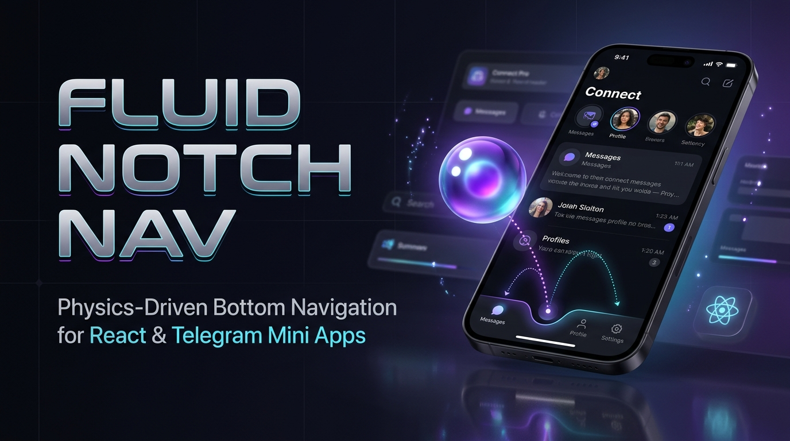
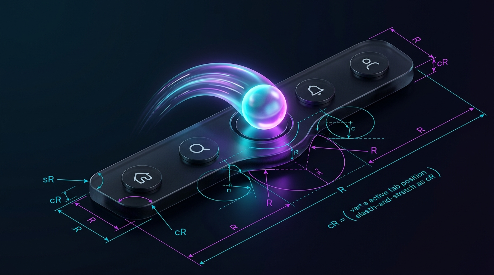
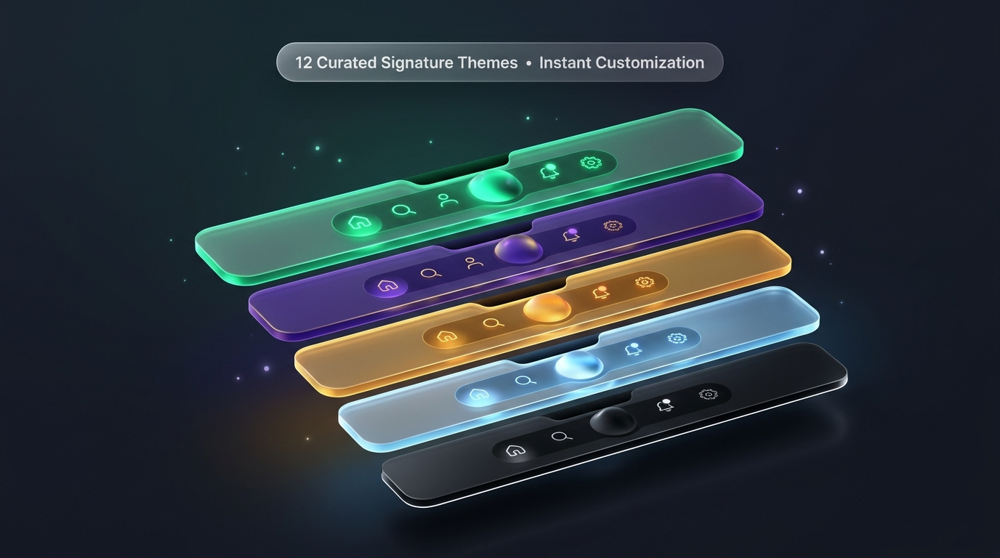

# 🔮 Fluid Notch Nav

<p align="center">
  
</p>

<p align="center">
  <strong>A fluid, physics-driven bottom navigation dock for React & Telegram Mini Apps.</strong><br />
  Featuring an adaptive SVG notch cutout, floating 3D glass orb, jelly stretch physics, frosted glassmorphism, and multi-stage tactile haptic feedback.
</p>

<p align="center">
  <strong>English</strong> | <a href="README.ru.md"><strong>Русский</strong></a>
</p>

<p align="center">
  <a href="https://github.com/VovanBloger/fluid-notch-nav/stargazers"></a>
  <a href="https://react.dev"></a>
  <a href="https://nextjs.org"></a>
  <a href="https://tailwindcss.com"></a>
  <a href="https://core.telegram.org/bots/webapps"></a>
  <a href="LICENSE"></a>
</p>

---

## 🌟 Overview

**Fluid Notch Nav** is a production-grade bottom navigation component engineered for high-polish mobile web applications, responsive dashboards, and Telegram Mini Apps.

Unlike standard static navigation bars, **Fluid Notch Nav** treats navigation as a continuous physical surface. When switching tabs, the navigation bar dynamically carves an organic SVG notch while a floating glass orb launches along a parabolic kinetic trajectory, deforming with jelly-physics elasticity before settling into its destination pocket with magnetic deceleration and tactile haptic feedback.

---

## 🚀 Key Features

### 🔮 1. Adaptive Floating Orb (2D Flat & 3D Glass Sphere)
- **Glass 3D Sphere**: Dual top-rim and bottom-rim specular highlights, glass refractive reflection, and deep radial shadow.
- **Minimalist 2D Flat**: Clean, modern solid/gradient circle for minimalist design systems.
- Smooth icon cross-fading during transit.

### 📐 2. Modular SVG Symmetrical Notch Math
- Continuous Bézier and arc generation (`lib/notch-math.ts`) that guarantees $C^1$ mathematical continuity.
- Dynamic shoulder radius ($sR$) and corner radius ($cR$) compression prevents clipping, self-intersections, or pinched geometry when tabs reach outer panel edges.

<p align="center">
  
</p>

### ⚡ 3. Jelly Stretch Physics & Non-Linear Flight
- **Takeoff**: Rapid acceleration impulse upon tap.
- **Flight (Transit)**: Velocity-proportional stretch (`scaleX: 1.14`, `scaleY: 0.88`) along the motion vector.
- **Landing**: Elastic overshoot absorption (`scaleX: 0.96`, `scaleY: 1.04`) with magnetic damping into the resting notch cavity.

### 🪟 4. Hardware-Accelerated Glassmorphism
- SVG mask layer coupled with native `backdrop-filter: blur(22px)` ensures real-time frosted glass refraction over any underlying background, image feed, or canvas.

### 🎨 5. 12 Curated Signature Themes
- **Cyber Emerald**: Neon mint glow on emerald titanium.
- **Royal Amethyst**: Deep imperial purple with neon violet glow.
- **Sunset Amber**: Golden honey and rich amber glass.
- **Arctic Cyan**: Electric cyan frost and ice highlights.
- **Obsidian Void**: Deep carbon titanium monochrome.
- **Velvet Dusk**: Crimson wine and soft gold reflections.
- And 6 additional classic presets with full runtime theme overrides!

<p align="center">
  
</p>

### 📳 6. Multi-Platform Haptics & Sound Engine
- **Telegram Mini Apps**: Native `HapticFeedback.selectionChanged()` and `impactOccurred('light')`.
- **Mobile Browsers**: Android `navigator.vibrate([15, 20])`.
- **Desktop Browsers**: Built-in synthetic audio click generator via `Web Audio API` (realistic mechanical spring click).

### 🏝️ 7. Floating Capsule Dock Mode
- Set `bottomCornerRadius` to transform the docked bar into an iOS floating island capsule.

---

## 📦 Quick Start (Interactive Studio)

### 1. Clone the repository
```bash
git clone https://github.com/VovanBloger/fluid-notch-nav.git
cd fluid-notch-nav
```

### 2. Install dependencies
```bash
npm install
```

### 3. Start development server
```bash
npm run dev
```

Open [http://localhost:3000](http://localhost:3000) to launch the **Interactive Testbench Studio**, where you can tweak geometry sliders, test slow-motion physics, switch themes, and copy generated JSX.

---

## 💻 Integration into Your React / Next.js Project

Copy `components/AdaptiveNotchNav.tsx`, `lib/notch-math.ts`, and `lib/haptics.ts` into your codebase:

```tsx
'use client';

import React, { useState } from 'react';
import { Home, Compass, PlusCircle, User } from 'lucide-react';
import { AdaptiveNotchNav, NavItem } from '@/components/AdaptiveNotchNav';

const NAV_ITEMS: NavItem[] = [
  { id: 'home', label: 'Home', icon: Home },
  { id: 'explore', label: 'Explore', icon: Compass, badge: 'NEW' },
  { id: 'create', label: 'Create', icon: PlusCircle },
  { id: 'profile', label: 'Profile', icon: User, badge: 3 },
];

export default function MobileScreen() {
  const [activeTab, setActiveTab] = useState('home');

  return (
    <div className="relative min-h-screen bg-[#08080E] text-white flex flex-col justify-end">
      {/* Scrollable content */}
      <main className="flex-1 p-4 pb-28">
        <h1 className="text-xl font-bold">Current Tab: {activeTab}</h1>
      </main>

      {/* Fluid Notch Navigation Dock */}
      <AdaptiveNotchNav
        items={NAV_ITEMS}
        activeTab={activeTab}
        onSelectTab={(id) => setActiveTab(id)}
        theme="cyber-emerald"
        orbStyle="3d"
        navMode="notch"
      />
    </div>
  );
}
```

---

## 🛠 Component API Reference

### `AdaptiveNotchNavProps`

| Prop | Type | Default | Description |
| :--- | :--- | :--- | :--- |
| `activeTab` | `string` | *(Required)* | ID of the currently active tab. |
| `onSelectTab` | `(tabId: string) => void` | *(Required)* | Callback fired on tab selection. |
| `items` | `NavItem[]` | `DEFAULT_STANDARD_TABS` | Array of tab items. |
| `theme` | `NavThemePreset \| NavThemeConfig` | `'obsidian-titanium'` | Preset name or custom theme object. |
| `navMode` | `'notch' \| 'pill'` | `'notch'` | `'notch'` for floating 3D orb; `'pill'` for sliding capsule pill. |
| `orbStyle` | `'3d' \| 'flat'` | `'3d'` | Glass 3D sphere with specular highlights or clean 2D circle. |
| `badgeBehavior` | `'orb-satellite' \| 'label-inline'` | `'orb-satellite'` | Where active badge migrates. |
| `showLabels` | `boolean` | `true` | Whether to display tab labels under icons. |
| `bottomCornerRadius` | `number` | `0` | Radius in px for bottom corners (`0` = docked, `24` = floating capsule). |
| `speedMultiplier` | `number` | `1.0` | Transit flight animation speed multiplier (e.g. `0.25` for slow-motion). |
| `hapticProfile` | `'mechanical' \| 'crisp' \| 'soft' \| 'none'` | `'mechanical'` | Haptic feedback vibration profile. |

---

### `NavItem` Interface

```ts
export interface NavItem<T extends string = string> {
  id: T;
  label: string;
  icon: ComponentType<{ size?: number; strokeWidth?: number; className?: string }>;
  activeIcon?: ComponentType<{ size?: number; strokeWidth?: number; className?: string }>;
  badge?: number | string;
  badgeColor?: string;
  renderIcon?: (tab: NavItem<T>, ctx: NavIconRenderContext) => React.ReactNode;
}
```

---

## 🧪 Unit Tests

Mathematical continuity, dynamic ease curves, and edge cases are verified with native Node.js tests:

```bash
npm test
```

```
✔ getTabCenterX distributes tabs evenly across container width
✔ buildSymmetricalNotch generates valid SVG path for docked and island modes
✔ buildFlatPanel generates valid SVG path
✔ calculateDynamicEase starts at 0, ends at 1, and exhibits micro-overshoot
✔ calculateTransitDuration respects slow-motion multipliers below 1.0x
✔ computeFramePhysics produces C1-continuous scaleX/scaleY without jump at t=0.88
```

---

## 🏗 Project Architecture

```
fluid-notch-nav/
├── app/
│   ├── globals.css              # Tailwind CSS v4 setup and kinetic keyframes
│   ├── layout.tsx               # Root layout and font configurations
│   └── page.tsx                 # Interactive Testbench Studio
├── components/
│   └── AdaptiveNotchNav.tsx     # The core navigation component
├── lib/
│   ├── haptics.ts               # Telegram, Android, and Web Audio haptic engine
│   ├── notch-math.ts            # Modular SVG notch & physics math
│   ├── notch-math.test.ts       # Automated math & continuity tests
│   └── utils.ts                 # Class merging utilities
├── docs/
│   └── assets/                  # 8K Rendered banners and showcase diagrams
├── public/                      # Static assets
├── package.json
└── tsconfig.json
```

---

## 🤝 Contributing

Contributions, issues, and feature requests are welcome!
Feel free to check [issues page](https://github.com/VovanBloger/fluid-notch-nav/issues).

1. Fork the Project
2. Create your Feature Branch (`git checkout -b feature/amazing-theme`)
3. Commit your Changes (`git commit -m 'feat: Add Solar Amber theme'`)
4. Push to the Branch (`git push origin feature/amazing-theme`)
5. Open a Pull Request

---

## 📄 License

Distributed under the **MIT License**. See `LICENSE` for more information.

<p align="center">
  Crafted with precision by <a href="https://github.com/VovanBloger"><strong>@VovanBloger</strong></a>
</p>
