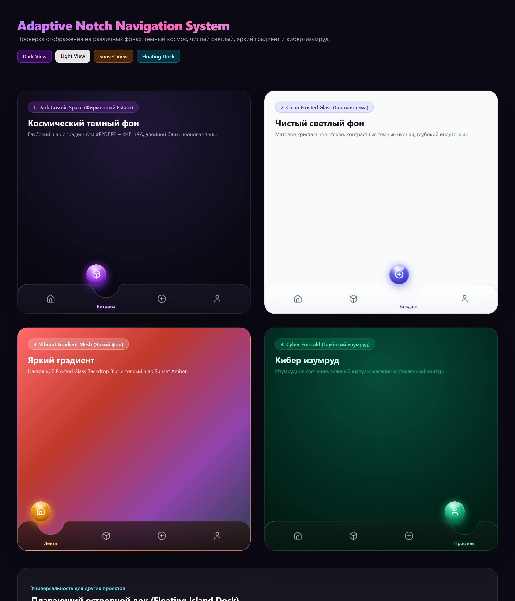
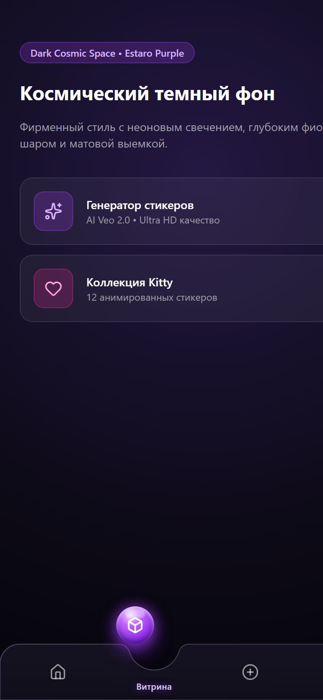
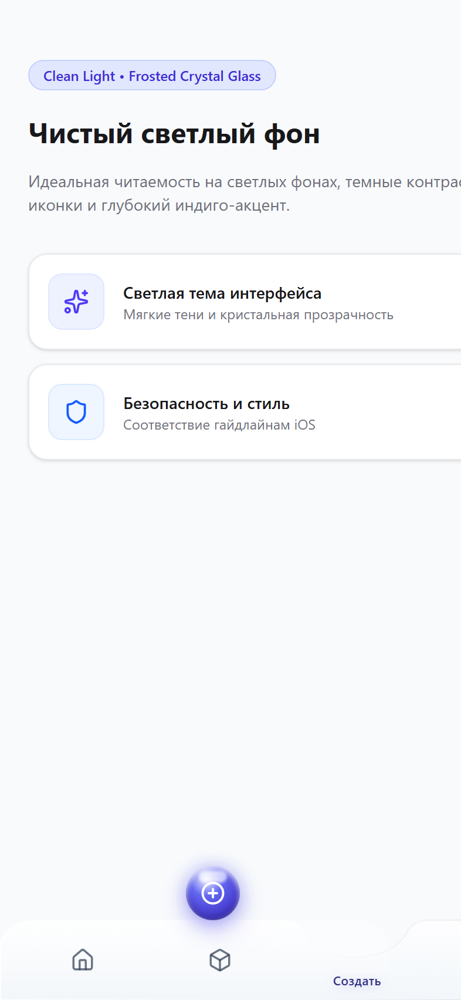
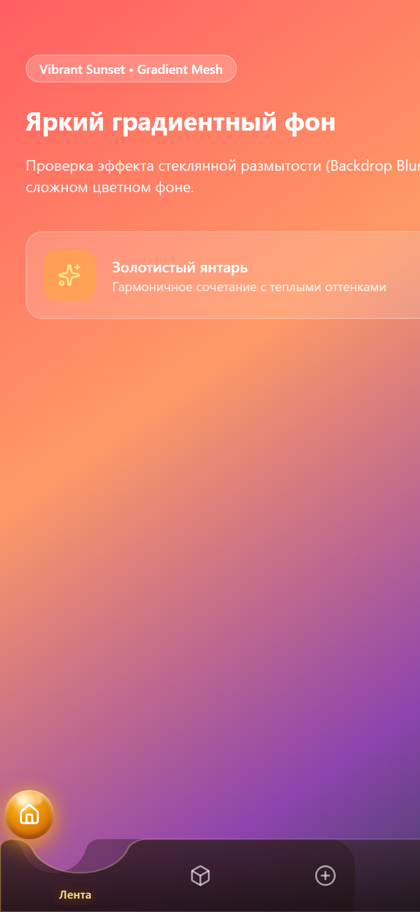
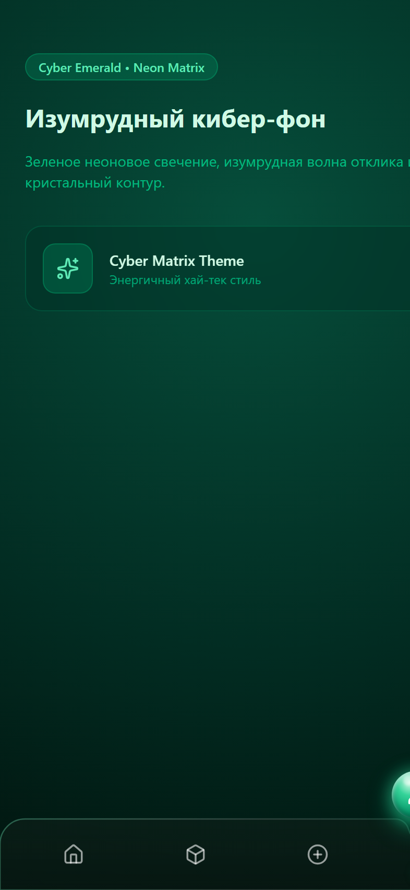
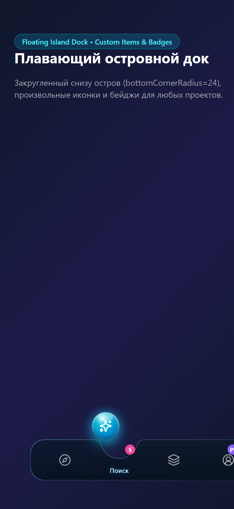

# Fluid Notch Navigation

<p align="center">
  
</p>

<p align="center">
  <strong>A fluid, physics-driven bottom navigation bar with an adaptive SVG notch, floating orb, frosted glassmorphism, and tactile haptic feedback.</strong><br />
  <em>Engineered for React, Next.js, and Telegram Mini Apps.</em>
</p>

<p align="center">
  
  
  
  
  
</p>

---

## 🌟 Features

- 🔮 **Floating Orb Mechanism:** The active item floats in a glowing 3D-lit sphere with dual specular glass reflections.
- 📐 **Dynamic Mathematical SVG Notch:** Smooth, symmetrical cutout generated on the fly. Dynamically adapts shoulder and corner radii so edges never pinch, overlap, or loop back.
- ⚡ **Non-Linear Physical Velocity:** No robotic uniform speeds! Swift takeoff impulse, high-speed cruise phase, and gentle magnetic deceleration into the target notch pocket.
- 🧪 **Jelly Stretch Physics:** The floating orb organically elongates along the axis of movement during high-velocity transit (`scaleX: 1.15`), with an elastic cushion upon landing (`scaleX: 0.96`).
- 🪟 **True Frosted Glassmorphism:** SVG `<clipPath>` ensures native hardware-accelerated `backdrop-filter: blur(20px)` behind the exact cutout curve across any background.
- 📳 **Synchronized Haptic Feedback:** Multi-stage tactile ticks synchronized with the physics engine (works in Telegram WebApps via `HapticFeedback`, on Android via `navigator.vibrate`, and on desktop via synthetic Web Audio ticks).
- 🏝️ **Floating Island Dock Mode:** Supports custom `bottomCornerRadius` to transform from a standard bottom dock into an iOS-style floating pill island.
- 🎨 **Modular Themes & Customization:** 6 built-in themes + full support for custom colors, icons, labels, and badges.

---

## 📸 Screenshots across Different Backgrounds

| Dark Cosmic Space | Clean Light (Frosted Glass) | Vibrant Sunset Mesh |
|:---:|:---:|:---:|
|  |  |  |

| Cyber Emerald Matrix | Floating Island Dock |
|:---:|:---:|
|  |  |

---

## 🚀 Quick Start

### 1. Installation

Copy `src/components/AdaptiveNotchNav.tsx` and `src/lib/haptics.ts` into your project, or install peer dependencies:

```bash
npm install lucide-react
```

### 2. Usage

```tsx
'use client';

import React, { useState } from 'react';
import { AdaptiveNotchNav, NavItem } from './components/AdaptiveNotchNav';
import { Home, Compass, PlusCircle, User } from 'lucide-react';

const TABS: NavItem[] = [
  { id: 'home', label: 'Home', icon: Home },
  { id: 'explore', label: 'Explore', icon: Compass },
  { id: 'create', label: 'Create', icon: PlusCircle },
  { id: 'profile', label: 'Profile', icon: User, badge: 'PRO', badgeColor: '#8B5CF6' },
];

export default function App() {
  const [activeTab, setActiveTab] = useState('home');

  return (
    <div className="min-h-screen bg-[#090810] flex flex-col justify-between">
      <main className="p-6 text-white">
        <h1>Current tab: {activeTab}</h1>
      </main>

      {/* Fluid Notch Navigation */}
      <AdaptiveNotchNav
        items={TABS}
        activeTab={activeTab}
        onSelectTab={setActiveTab}
        theme="purple-neon"
      />
    </div>
  );
}
```

---

## 🏝️ Floating Island Dock Mode

To float the dock above the bottom edge with rounded bottom corners (like iOS Dynamic Island):

```tsx
<div className="max-w-[400px] mx-auto w-full pb-4 px-2">
  <AdaptiveNotchNav
    items={TABS}
    activeTab={activeTab}
    onSelectTab={setActiveTab}
    bottomCornerRadius={24} // Turns on island rounding
    theme="clean-light"     // Light frosted crystal theme
  />
</div>
```

---

## 🎨 Built-in Theme Presets

You can pass any preset name to `theme`:

- `'purple-neon'` — Signature ultraviolet neon glow with deep violet orb (Default).
- `'cyber-emerald'` — High-tech emerald matrix with green tactile resonance.
- `'sunset-amber'` — Warm golden amber with sunset glow.
- `'electric-cyan'` — Azure cyber blue with cyan glow.
- `'clean-light'` — Frosted white crystal glass with slate contrast icons.
- `'mono-dark'` — Minimalist monochrome Nordic style.

### Custom Theme Object

You can also pass a custom theme configuration:

```tsx
<AdaptiveNotchNav
  items={TABS}
  activeTab={activeTab}
  onSelectTab={setActiveTab}
  theme={{
    orbGradient: 'radial-gradient(circle at 35% 25%, #FFE259 0%, #FFA751 100%)',
    orbGlow: '0 8px 24px rgba(255, 167, 81, 0.65)',
    orbIconColor: '#FFFFFF',
    glassFillStart: 'rgba(255, 255, 255, 0.8)',
    glassFillEnd: 'rgba(240, 240, 245, 0.95)',
    backdropBlur: '24px',
    activeLabelColor: '#D97706',
    inactiveColor: '#6B7280',
    waveColor: '#F59E0B',
    hapticProfile: 'mechanical',
  }}
/>
```

---

## ⚙️ Props Reference

| Prop | Type | Default | Description |
|:---|:---|:---|:---|
| `activeTab` | `string` | **Required** | The ID of the currently selected tab. |
| `onSelectTab` | `(tabId: string) => void` | **Required** | Callback invoked when a tab is pressed. |
| `items` | `NavItem[]` | `DEFAULT_STANDARD_TABS` | Array of tab items (supports 3, 4, 5+ tabs). |
| `theme` | `NavThemePreset \| NavThemeConfig` | `'purple-neon'` | Theme preset string or custom color object. |
| `bottomCornerRadius` | `number` | `0` | Radius for bottom corners (`0` = docked, `24` = floating island). |
| `showLabels` | `boolean` | `true` | Whether to display labels under the active notch. |
| `hapticProfile` | `'mechanical' \| 'crisp' \| 'soft' \| 'none'` | `'mechanical'` | Haptic feedback profile. |
| `navMode` | `'notch' \| 'pill'` | `'notch'` | Animation mode (`notch` with floating orb or `pill` slider). |

---

## 🎮 Standalone Interactive HTML Demo

Want to test it without React? Open `demo/index.html` directly in any web browser. It contains a full interactive phone simulator with background switchers, theme toggles, and live slow-motion telemetry.

---

## 📄 License

MIT © [Vladimir (VovanBloger)](https://github.com/VovanBloger)
