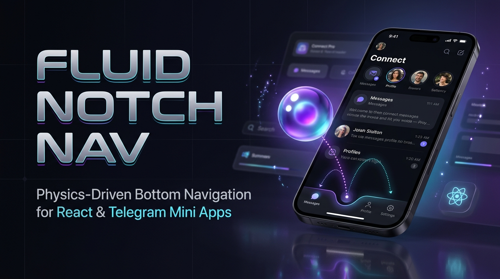
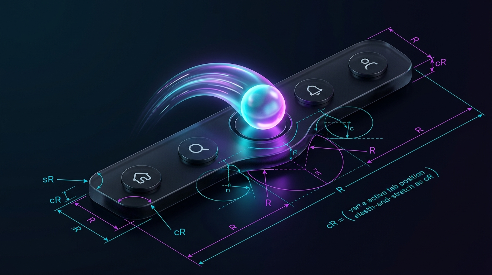
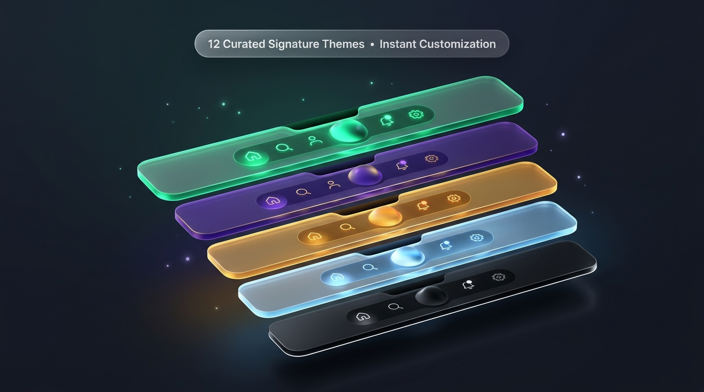

# 🔮 Fluid Notch Nav

<p align="center">
  
</p>

<p align="center">
  <strong>Плавная физическая нижняя панель навигации для React и Telegram Mini Apps.</strong><br />
  Адаптивный вырез SVG, парящая 3D-стеклянная сфера, желейная физика деформации при полете, матовое стекло (glassmorphism) и многоуровневый тактильный виброотклик.
</p>

<p align="center">
  <a href="README.md"><strong>English</strong></a> | <strong>Русский</strong>
</p>

<p align="center">
  <a href="https://github.com/VovanBloger/fluid-notch-nav/stargazers"></a>
  <a href="https://react.dev"></a>
  <a href="https://nextjs.org"></a>
  <a href="https://tailwindcss.com"></a>
  <a href="https://core.telegram.org/bots/webapps"></a>
  <a href="LICENSE"></a>
</p>

---

## 🌟 О проекте

**Fluid Notch Nav** — готовый к продакшену UI-компонент нижней навигации (bottom dock) с физической анимацией, разработанный для современных веб-приложений, мобильных дашбордов и Telegram Mini Apps.

В отличие от стандартных плоских навигационных панелей, **Fluid Notch Nav** работает как единая динамическая поверхность:
1. При переключении вкладки навигационная панель органично вырезает контур выемки с помощью динамического SVG-пути.
2. Активная сфера плавно взлетает по баллистической параболе, вытягивается в полете под действием инерции (jelly stretch physics) и мягко приземляется в новое гнездо с эффектом упругого сплющивания и тактильной отдачей.
3. Полная математическая симметрия плеч выреза исключает любые перекосы и артефакты даже на крайних табах (например, "Лента" или "Профиль").

---

## 🚀 Ключевые возможности

### 🔮 1. Парящая сфера (2D Flat и 3D Glass Sphere)
- **3D Glass Sphere**: Реалистичный стеклянный шар с верхним и нижним бликами, световыми ободками и глубокой объемной тенью.
- **2D Flat**: Минималистичный круг с градиентом для строгих дизайн-систем.
- Плавная смена иконки внутри сферы (cross-fade) прямо в полете без скачков.

### 📐 2. Симметричная аналитическая геометрия SVG (`lib/notch-math.ts`)
- Генерация дуг гарантирует гладкое сопряжение $C^1$ между плоским краем панели и полукруглой выемкой.
- Автоматическая динамическая адаптация радиуса плеч ($sR$) предотвращает наплывы и срезы на крайних вкладках.

<p align="center">
  
</p>

### ⚡ 3. Желейная физика (Jelly Physics) и кинематика
- **Старт**: Моментальный отклик на касание (pointerdown).
- **Полет**: Пропорциональное удлинение вдоль вектора скорости (`scaleX: 1.14`, `scaleY: 0.88`).
- **Посадка**: Эластичное демпфирование и гашение колебаний (`scaleX: 0.96`, `scaleY: 1.04`) в ложе выреза.
- Высота подскока ограничена (до 4.5px), благодаря чему сфера всегда остается в гнезде выреза и не перекрывает контент приложения.

### 🪟 4. Аппаратно-ускоренный Glassmorphism
- SVG-маска в сочетании с нативным `backdrop-filter: blur(22px)` создает эффект настоящего матового стекла поверх ленты постов, фото или карточек.

### 🎨 5. 12 авторских готовых тем
- **Obsidian Titanium**: Темный матовый титан и глубокое затемнение.
- **Royal Amethyst / Purple Neon**: Насыщенный фиолетовый неон.
- **Cyber Emerald**: Неоновый мятно-изумрудный киберпанк.
- **Sunset Amber**: Янтарный мед и теплый закатный свет.
- **Arctic / Electric Cyan**: Морозный ледяной циан.
- **Clean Light**: Чистая светлая тема для белых интерфейсов.
- Полная поддержка передачи любого кастомного объекта темы с вашими градиентами и свечением!

<p align="center">
  
</p>

### 📳 6. Мультиплатформенный тактильный виброотклик (Haptics)
- **Telegram Mini Apps**: Нативные вызовы `Telegram.WebApp.HapticFeedback`.
- **Мобильные браузеры (Android)**: `navigator.vibrate([15, 20])`.
- **Десктопные браузеры**: Синтетический щелчок механической пружины через `Web Audio API`.

### 🏝️ 7. Режим плавающей капсулы (Island Capsule)
- Параметр `bottomCornerRadius` превращает прижатую панель в парящую iOS-капсулу со скругленными нижними углами.

---

## 📦 Быстрый запуск интерактивной студии

В репозиторий включена полноценная **Студия-стенд (Testbench Studio)** с интерактивными регуляторами физики, слайдером замедления полета (slow-motion), телеметрией и возможностью копировать сгенерированный JSX.

### 1. Клонируйте репозиторий
```bash
git clone https://github.com/VovanBloger/fluid-notch-nav.git
cd fluid-notch-nav
```

### 2. Установите зависимости
```bash
npm install
```

### 3. Запустите сервер разработки
```bash
npm run dev
```

Откройте [http://localhost:3000](http://localhost:3000) в браузере.

---

## 💻 Интеграция в ваш проект на React / Next.js

Скопируйте файлы `components/AdaptiveNotchNav.tsx`, `lib/notch-math.ts` и `lib/haptics.ts` в ваш проект:

```tsx
'use client';

import React, { useState } from 'react';
import { Home, Compass, PlusCircle, User } from 'lucide-react';
import { AdaptiveNotchNav, NavItem } from '@/components/AdaptiveNotchNav';

const NAV_ITEMS: NavItem[] = [
  { id: 'home', label: 'Главная', icon: Home },
  { id: 'explore', label: 'Обзор', icon: Compass, badge: 'NEW' },
  { id: 'create', label: 'Создать', icon: PlusCircle },
  { id: 'profile', label: 'Профиль', icon: User, badge: 3 },
];

export default function App() {
  const [activeTab, setActiveTab] = useState('home');

  return (
    <div className="relative min-h-screen bg-[#08080E] text-white flex flex-col justify-end">
      {/* Основной контент */}
      <main className="flex-1 p-4 pb-28">
        <h1 className="text-xl font-bold">Активная вкладка: {activeTab}</h1>
      </main>

      {/* Нижняя навигация Fluid Notch */}
      <AdaptiveNotchNav
        items={NAV_ITEMS}
        activeTab={activeTab}
        onSelectTab={(id) => setActiveTab(id)}
        theme="purple-neon"
        orbStyle="3d"
        navMode="notch"
      />
    </div>
  );
}
```

---

## 🛠 Параметры компонента (API Reference)

### `AdaptiveNotchNavProps`

| Проп | Тип | По умолчанию | Описание |
| :--- | :--- | :--- | :--- |
| `activeTab` | `string` | *(Обязательный)* | ID текущей активной вкладки. |
| `onSelectTab` | `(tabId: string) => void` | *(Обязательный)* | Колбэк при выборе вкладки. |
| `items` | `NavItem[]` | `DEFAULT_STANDARD_TABS` | Массив вкладок меню (id, label, icon, badge). |
| `theme` | `NavThemePreset \| NavThemeConfig` | `'obsidian-titanium'` | Название встроенного пресета или объект кастомной темы. |
| `navMode` | `'notch' \| 'pill'` | `'notch'` | `'notch'` — вырез и парящая сфера; `'pill'` — скользящая капсула. |
| `orbStyle` | `'3d' \| 'flat'` | `'3d'` | Объемная 3D-сфера с бликами или плоский 2D-круг. |
| `badgeBehavior` | `'orb-satellite' \| 'label-inline'` | `'orb-satellite'` | Поведение бейджа (на сфере сверху-справа или возле подписи). |
| `showLabels` | `boolean` | `true` | Показывать текстовые подписи под иконками. |
| `bottomCornerRadius` | `number` | `0` | Радиус нижних углов (`0` — прижато к низу, `24` — парящий остров). |
| `speedMultiplier` | `number` | `1.0` | Множитель скорости анимации (например `0.3` для замедленного режима). |
| `hapticProfile` | `'mechanical' \| 'crisp' \| 'soft' \| 'none'` | `'mechanical'` | Профиль тактильной вибрации. |

---

## 🧪 Модульные тесты

Математическая точность дуг, непрерывность производных и поведение физики проверяются тестами:

```bash
npm test
```

```
✔ getTabCenterX distributes tabs evenly across container width
✔ buildSymmetricalNotch generates valid SVG path for docked and island modes
✔ buildFlatPanel generates valid SVG path
✔ calculateDynamicEase starts at 0, ends at 1, and exhibits micro-overshoot
✔ calculateTransitDuration respects slow-motion multipliers below 1.0x
✔ computeFramePhysics produces C1-continuous scaleX/scaleY without jump at t=0.88
```

---

## 📄 Лицензия

Проект распространяется под свободной лицензией **MIT**. Подробности в файле `LICENSE`.

<p align="center">
  Создано с вниманием к деталям: <a href="https://github.com/VovanBloger"><strong>@VovanBloger</strong></a>
</p>
